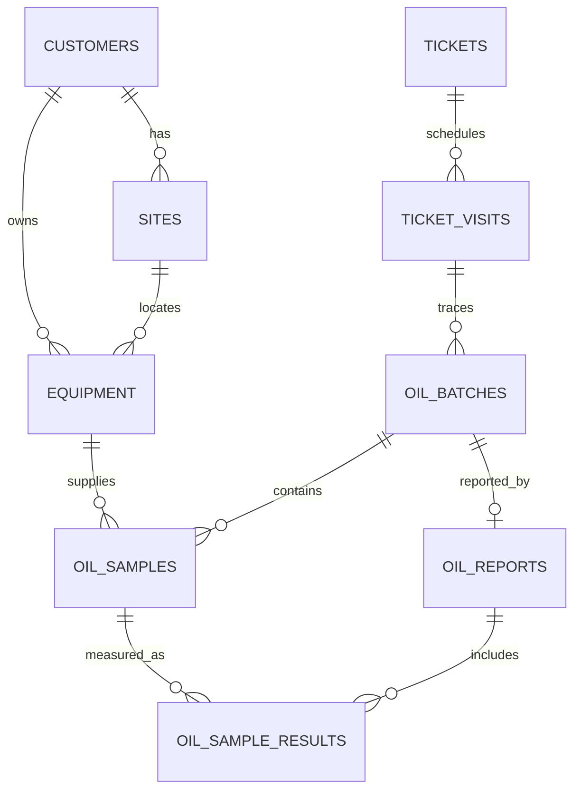

# Core Data Model

The oil-analysis feature is built on top of the normal field-service hierarchy. Most relationship columns are integer IDs, so correct linking is an application responsibility rather than a database guarantee.

## Relationship rules

- A transformer is an `equipment` row, not a separate transformer table.
- An oil batch has **many** samples via `oil_sample.oil_batch_id`.
- A sample points to one transformer/equipment record and may carry the originating visit.
- A report aggregates result rows for selected samples in a batch.
- Code treats a batch as having one report (`OilBatch::oilReport()` is `hasOne`), but confirm this invariant before creating a second report because the database does not enforce it.
- Historical comparison rows are not new physical samples; they are identified through `used_oil_sample`.

## Migration reading order

Read the initial create migration and all subsequent alters. Key tables include `equipment`, `tickets`, `ticket_visits`, `line_items`, `oil_batches`, `oil_sample`, `oil_reports`, and `oil_sample_results`.
