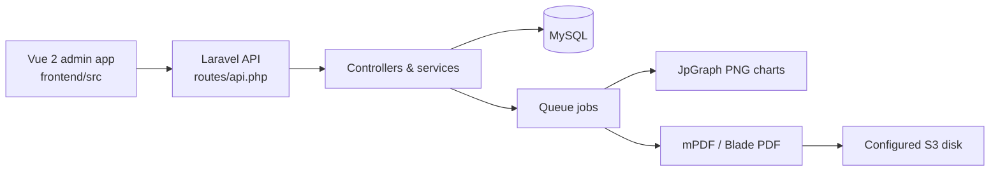

# System Architecture

CM Werkz is a Laravel application that exposes an API to a Vue 2 single-page admin application. Business rules, persistence, document assembly, and background work remain on the server; the browser owns interactive listing, create, detail, and report screens.

## Source map

| Concern | Starting point |
| --- | --- |
| Browser route and page | `frontend/src/router.js`, then `frontend/src/view/pages/` |
| API route | `routes/api.php` |
| Validation and writes | Feature controller plus request/model code |
| Persistence shape | Create migration and all later migrations for the table |
| Oil PDF jobs | `PrepareOilReportPDF`, `SaveReportImage`, `GenerateOilReportPDF` |
| PDF/chart logic | `app/Traits/OilReportTrait.php`, `app/Traits/PDFTrait.php` |

## Design rule

Do not place authoritative business calculations or authorization checks solely in Vue. Server code must validate tenant/customer scope and own durable state transitions; the frontend should present API state and route users to the owning record.
