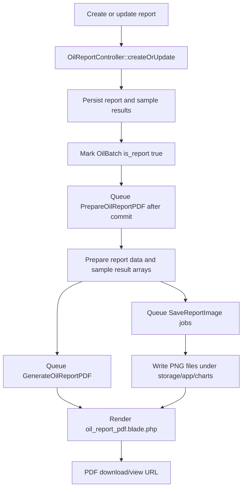

# Oil Report — PDF, Graph, Table, and Result Rules

## Scope

This document records the verified conditions used by the Oil Report frontend, `OilReportController`, `OilReportTrait`, the PDF Blade template, and the PDF jobs. It explains exactly when tables and graphs are shown or omitted.

## Main files

| Area | File |
|---|---|
| Report listing | `frontend/src/view/pages/oil-report-generator/Oil-Report.vue` |
| Create/edit report | `frontend/src/view/pages/oil-report-generator/Create-Oil-Report.vue` |
| Report detail | `frontend/src/view/pages/oil-report-generator/Detail-Oil-Report.vue` |
| Browser result tables | `frontend/src/view/pages/oil-report-generator/detail/OilAnalysisReport.vue` |
| Browser transformer sample tables | `frontend/src/view/pages/oil-report-generator/detail/TransformerSampleData.vue`, `OilAnalysisReportDetail.vue` |
| PDF preparation | `app/Http/Controllers/OilReportController.php::prepareOilReportPDF()` |
| PDF queue dispatch | `OilReportController::generateOilReportPDF()`, `retryOilReportPDF()` |
| Chart image job | `app/Jobs/SaveReportImage.php` |
| PDF preparation job | `app/Jobs/PrepareOilReportPDF.php` |
| PDF rendering job | `app/Jobs/GenerateOilReportPDF.php` |
| Chart calculation | `app/Traits/OilReportTrait.php::generate_oil_report_images()` |
| PDF template | `resources/views/pdf/oil_report_pdf.blade.php` |

## Report lifecycle



`PrepareOilReportPDF` and `GenerateOilReportPDF` use three attempts, a 1,800-second timeout, backoff `[30, 60, 120]`, and retry for up to two hours. `SaveReportImage` also uses three attempts and the same long timeout/retry window.

## Frontend report pages

### Listing page: `Oil-Report.vue`

Verified actions include:

- Create: shown when `oil-report:create` permission is available; routes to the report create page.
- Open report/customer/sample-related records: row links call router navigation with the report ID.
- Download PDF: the download icon calls `viewPDF(data?.sample_pdf_url)` when a PDF URL is present.
- Search/filter: the search dialog calls `filterRows`; `removeFilters('clear')` clears the active filters.
- Status action: the listing uses a PATCH request through the store; the exact status payload must be traced before changing it.
- Export: the page dispatches the download action for the current report list.

### Item page: `Detail-Oil-Report.vue`

- Edit: `editOilSample()` routes to the report edit screen.
- View PDF: calls `viewPDF(detail?.sample_pdf_url)`.
- Retry PDF: calls `POST oil-report/{id}/retry-pdf` and queues PDF generation again.
- Back: calls `goBack`.
- Load: calls `GET oil-report/{id}`.
- Related sample links: navigate to the related oil sample or equipment records.

### Create/edit page: `Create-Oil-Report.vue`

- Save: `updateOrCreate('save')`; normal report submission.
- Save draft: `updateOrCreate('draft')`; the backend receives `type = draft`.
- Back: calls `goBack`.
- Visit and batch selectors load report options and batch/sample data.
- DGA, acid, and furan Excel upload controls call `POST report-excel/{type}`.
- Uploaded files can be removed from the current sample before saving.
- A non-draft save requires sample result, sample date, and sample status checks in `updateOrCreate()`.

## Browser result tables

`OilAnalysisReport.vue` renders separate result tables for DGA, Water Content, Acidity, Dielectric Strength, and Furans. The sections are part of the report/sample editor and are not the same as the PDF graph conditions.

### Route-dependent controls

When the route contains `oilsample`:

- Add-row controls are hidden.
- Action columns and delete controls are hidden.
- The report-level editable result row is hidden.
- Existing result rows can still be displayed.

When the route does not contain `oilsample`:

- Add-row controls are available.
- The current report result row is available for editing.
- Delete/action controls are available for transformer sample rows.

### Browser table content rules

- DGA displays the current result plus transformer sample rows when their type/data matches DGA fields.
- Water Content displays the current result and rows whose type is `waterContent` or that contain water data.
- Acidity displays the current acid result and rows whose type is `acid` or that contain acid data.
- Dielectric Strength displays six readings, calculated mean, and CV%; rows are filtered by dielectric type/data.
- Furans displays 5HMF, 2FOL, 2FAL, 2ACF, 5MEF, total furans, and DPv; rows are filtered by furan type/data.
- Empty numeric values are formatted as `-` or a detection-limit value by the component methods; this is display formatting and does not itself decide whether the PDF section exists.

## PDF section conditions

The PDF template is `resources/views/pdf/oil_report_pdf.blade.php`. The following rules are from the actual Blade conditions.

| PDF section | Condition to print section | Rows/values printed |
|---|---|---|
| Results Summary | The report PDF reaches the summary page. The table is rendered even if the sample collection is empty; with no rows, the header remains and no sample rows are added. | All `oilSample` rows, ordered status `3`, then `2`, then `1`, then other statuses. Columns are location, transformer ID, serial number, sample point, status, and retest date. |
| Sample detail header | One block for every item in `report['oilSample']`. | Sample ID, sampling date, location, sampled by, sample point, transformer data, status, summary, and retest date. |
| DGA table | `$isDgaExcelFileExist->isNotEmpty()`. `$dgaRows` first filters `dgaResult` rows where `tgv` is not null and takes at most three rows. The existence condition requires a non-empty/non-`null` `dga_document_id` in those rows. | Up to three dates and gas values. TGV, THGV, and TCG are recalculated in the template after applying display minimums. |
| Water Content table | The table is always emitted inside the Water/Acidity block. | Up to three rows from `waterContent` where `waterContent !== null`; if none exist, one placeholder row containing `-` is emitted. |
| Acidity table | The table is always emitted inside the Water/Acidity block. | Up to three rows from `acidResult` where `acidResult !== null`; if none exist, one placeholder row containing `-` is emitted. An Excel-source marker is separately calculated for graph inclusion. |
| Dielectric Strength table | The table is always emitted. `$dielRows` keeps rows where at least one of `first`, `second`, `third`, `fourth`, `fifth`, `sixth`, `mean`, or `temperature` is non-empty, then takes at most three. | Six readings, mean, CV%, temperature, electrode, and date. Empty/zero display values become `-` in the template. |
| Furan table | `$isFuranExcelFileExist->isNotEmpty()`. A furan row qualifies as data when at least one of `2fal`, `5hmf`, `2fol`, `2acf`, `5mef` is non-empty, or `dpv` is non-empty and not numeric zero. The first three qualifying rows are considered. The Excel condition requires a non-null `furan_document_id` and `source_priority = 1`. | Up to three dates, five furan compounds, total furans, and DPv. |
| Graph page | Only when the calculated image list contains at least one existing PNG: `is_dir($folderPath) && count($existingImages)`. | Existing PNG files are printed two per row, with up to seven images on the first graph page and remaining images on the next page. |
| Standards/reference table | Always printed after the sample graph/detail loop. | The landscape oil-test reference table for DGA, oil quality tests, and furan guidance values. |

## Exact graph inclusion conditions in the PDF

The PDF does not display a graph solely because a result table has values. It builds an ordered image list and then checks the PNG files under:

```text
storage/app/charts/{report_barcode}/{oil_sample_barcode}/
```

The PDF graph list is built as follows:

| Graph files | PDF inclusion condition |
|---|---|
| `hydrogen.png`, `methane.png`, `carbon_monoxide.png`, `carbon_dioxide.png`, `ethylene.png`, `ethane.png`, `acetylene.png` | At least three filtered DGA rows (`$hasEnoughDga`) **and** at least one qualifying `dga_document_id` (`$isDgaExcelFileExist->isNotEmpty()`). Each individual PNG must also exist. |
| `waterContent.png` | At least three non-null water-content rows (`$hasEnoughWaterContent`). The PDF graph condition does not require a water Excel document ID. The PNG must also exist. |
| `acidResult.png`, `acid.png` | At least three non-null acid rows (`$hasEnoughAcid`) **and** at least one acid row with a non-null document ID and `source_priority = 1`. Each PNG must also exist. |
| `electrode.png`, `cvMean.png` | At least three qualifying dielectric rows (`$hasEnoughDielectric`). Each PNG must also exist. |
| `dpv.png` | At least three qualifying furan rows (`$hasEnoughFuran`) **and** at least one furan row with a non-null document ID and `source_priority = 1`. The PNG must also exist. |

The first seven names in the ordered list are placed in the first graph page. Remaining images are placed on the next graph page. Missing individual PNGs are filtered out, so a section can meet its data condition but print fewer graph images than its full list.

## Important difference: chart generation vs PDF graph printing

`app/Traits/OilReportTrait.php::generate_oil_report_images()` prepares chart data by date and creates a chart when it finds at least **two numeric values** for that chart series:

```php
if (count($values) < 2) {
    continue;
}
```

Therefore:

- Two numeric dated values can be enough for the backend to generate a PNG.
- The PDF generally requires three qualifying rows for the corresponding graph condition.
- A PNG may exist but still not be selected by the PDF if the PDF threshold or source-document condition is not satisfied.
- A qualifying PDF condition can still produce no graph if the expected PNG file is missing.

Charts are grouped by date (`Y-m-d`), sorted chronologically, and use the first numeric row found for each date/group. Existing PNGs are skipped when the matching `.png.hash` matches the current chart data.

## Data formatting rules printed in the PDF

### DGA

- Null, empty, or `undetected` gas values print as a detection-limit string.
- Hydrogen below `4.5` is displayed as `<5`; oxygen below `499.5` as `<500`; nitrogen below `1999.5` as `<2000`; carbon monoxide/carbon dioxide below `24.5` as `<25`.
- Hydrocarbon values below `0.5` display as `<1`, values below `1` display as `1`, otherwise rounded values are printed.
- TCG, THGV, and TGV are calculated from normalized gas values in the Blade template.

### Water Content

- Rows with null `waterContent` are excluded from the data rows.
- Values are rounded to whole numbers.
- No-data state prints a placeholder `-` row, but that does not satisfy the three-row graph requirement.

### Acidity

- Null result prints `-`.
- Values below `0.005` print `<0.01`.
- Values from `0.005` to below `0.01` print `0.01`.
- Other values print with two decimal places.

### Dielectric Strength

- A row qualifies if any of the six readings, mean, or temperature is present and non-empty.
- Zero/empty display values become `-` for the table.
- CV is calculated from the numeric first-to-sixth readings when there is more than one reading; otherwise it prints `-`.

### Furans and DPv

- A furan row qualifies when at least one furan compound is present or DPv is non-zero/non-empty.
- Threshold display values are used: 5HMF `<0.02`, 2FOL `<0.04`, 2ACF `<0.03`, 5MEF `<0.03`, and 2FAL `<0.01` when below the configured detectable value.
- Total furans is calculated from threshold-qualified numeric values.
- Estimated DPv uses the first Furan `2fal` value; when it is missing, non-numeric, or not positive, the template uses `>1200`. Otherwise it applies the Chendong equation used in the Blade template.

## Status symbols in the summary

The summary table maps the sample status values as follows:

| Status | Printed symbol | Meaning from the PDF legend |
|---:|---|---|
| `1` | Check mark | Acceptable / satisfactory |
| `2` | `?` | Problem requiring further action |
| `3` | `X` | Serious problem requiring urgent action |
| Other/empty | `-` | No recognized status symbol |

## What to check when a table or graph is missing

1. Confirm the report contains the expected `oilSample` entry.
2. Inspect the prepared arrays: `dgaResult`, `waterContent`, `acidResult`, `dielectricResult`, `furanResult`, and `cvMean`.
3. Count the qualifying rows using the exact conditions above.
4. For DGA, acid, and furan graphs, confirm the relevant document ID and `source_priority = 1` where required.
5. Check the chart directory and expected PNG names under `storage/app/charts/{report}/{sample}/`.
6. Check `failed_jobs` and application logs for `SaveReportImage`, `PrepareOilReportPDF`, or `GenerateOilReportPDF` failures.
7. Use `POST oil-report/{oilreport}/retry-pdf` through the detail-page Retry PDF action after correcting the underlying data/job problem.

## Verified limitations

- The browser result tables and PDF tables do not use identical visibility rules.
- The PDF does not print a Water, Acidity, or Dielectric section only when data exists; those tables are emitted with placeholder rows when no qualifying rows exist.
- The PDF graph rules are stricter than chart generation and require both data thresholds and existing image files.
- Any additional browser print behavior outside `oil_report_pdf.blade.php` is Not verified.
