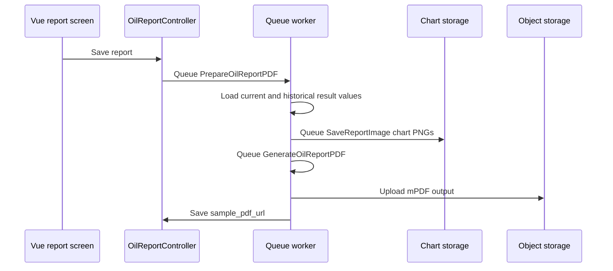

# Reports, Charts & PDF Generation

Report PDFs are generated by Laravel queue jobs, not by the browser. A successful save means work has been queued; it does not mean the PDF URL is immediately available.

## Chart inputs

- Current values come from `oil_sample_results` for the report sample.
- Historic values are selected for the **same transformer and same sample point**.
- The system prioritizes current report data, explicitly selected comparison samples, then other eligible historical results.
- At least two dated numeric values are required to render a trend. One-off samples show tables without a trend chart.

Charts cover DGA gases, water content, acidity, dielectric strength, estimated DPv, and furans. `OilReportTrait` writes temporary PNGs under `storage/app/charts/{report barcode}/{sample barcode}/`; the PDF Blade view embeds them and the generated files are removed after output.

## Retry safely

Use `POST /api/oil-report/{id}/retry-pdf` only after correcting the dependency failure: missing worker, invalid storage credentials, malformed result data, or inaccessible temporary storage. Verify the updated `oil_reports.sample_pdf_url` after the retry.
