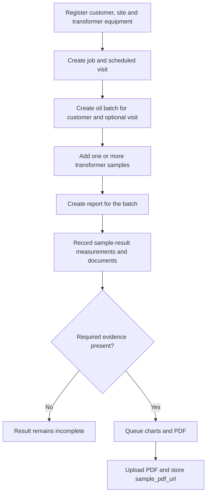

# End-to-End Oil Analysis Workflow

The oil workflow starts with field-service context and ends with an asynchronously produced customer-facing PDF. Keep each boundary explicit; an oil sample is not interchangeable with a job line item or a report result.

## Step-by-step behavior

1. **Register the asset.** Store transformer identity, location, oil type, barcode, and sample-point data on `equipment`.
2. **Schedule field work.** A `tickets` job may have many `ticket_visits`; visits contain the execution and assignment context.
3. **Create the batch.** An `oil_batches` row groups samples for a customer and, when known, a visit.
4. **Record samples.** Each `oil_sample` must have an `oil_batch_id` and points to one transformer.
5. **Create the report.** Creating an `oil_reports` row marks the batch as reportable (`is_report = true`).
6. **Enter measurements.** Each `oil_sample_results` row links report, batch, sample, and transformer and stores the analysis values.
7. **Complete evidence.** Current controller behavior considers a sample complete only when DGA, acid, and furan document IDs are present.
8. **Generate output.** Saving/queueing the report prepares historical values, produces chart files, creates a PDF, uploads it, and stores its URL.

## Change-impact checklist

If you add a measurement or change completion rules, trace: create/update validation, result serialization, history lookup, chart preparation, Blade PDF output, export/PDF tests, and frontend detail/create forms.
