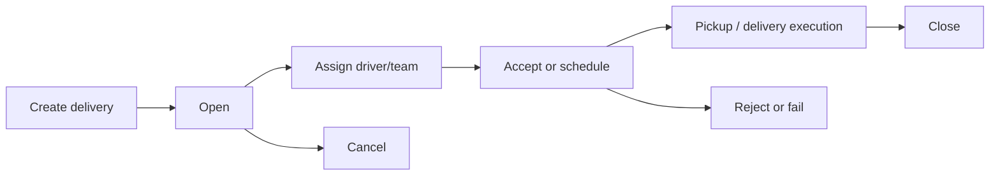
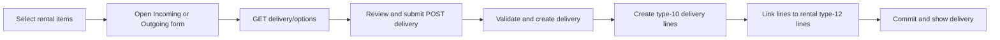

# Delivery Module KT

This document briefly explains the three delivery types and their common implementation flow.

## Delivery types

| Type | Purpose | Route |
|---|---|---|
| Incoming | Items coming back from a customer or supplier | `incoming-delivery` |
| Outgoing | Items delivered to a customer or site | `outgoing-delivery` |
| Transfer | Items moved between source and destination sites | `transfer-delivery` |

The value is stored in `deliveries.type` as `incoming`, `outgoing`, or `transfer`.

## Common frontend flow

Routes are defined in `frontend/src/router.js`. Main screens are:

- `frontend/src/view/pages/delivery/Delivery.vue` — listing shell.
- `frontend/src/view/pages/delivery/Delivery-Listing-Template.vue` — listing, filters, and actions.
- `frontend/src/view/pages/delivery/Delivery-Detail.vue` — detail and status actions.
- `frontend/src/view/pages/delivery/Delivery-Schedule.vue` — schedule.
- `frontend/src/view/pages/delivery/Delivery-Team.vue` — driver/team assignment.
- `frontend/src/view/pages/delivery/components/` — reusable delivery form sections.
- `frontend/src/view/pages/partials/Line-Item-V2.vue` — product and quantity form.
- `frontend/src/core/services/store/delivery.module.js` — delivery state and API calls.

### Incoming flow

The user selects Incoming, enters pickup/source information, selects products, schedules the pickup, assigns a driver/team, and submits. The request saves `deliveries.type = incoming`.

### Outgoing flow

The user selects Outgoing, enters customer/property and drop-off information, selects products, schedules delivery, assigns a driver/team, and submits. The request saves `deliveries.type = outgoing`.

### Transfer flow

The user selects Transfer, enters both source and destination information, selects products, schedules the movement, assigns a driver/team, and submits. Transfer validation requires `to_customer` and `to_property`. The request saves `deliveries.type = transfer`.

## Common backend flow

API routes are in `routes/api.php`:

```text
GET    delivery/options
GET    delivery/available-drivers
GET    deliveries
POST   delivery
PUT    delivery/{id}
GET    delivery/v1/{id}
PATCH  delivery/{delivery}/status
POST   dropoff-delivery
POST   delivery-force-close/{delivery}
DELETE delivery/{delivery}
```

The main backend class is `app/Http/Controllers/DeliveryController.php`.

`DeliveryController::updateOrCreateD1()`:

1. Validates header fields, schedule, line items, calculations, and transfer destination fields.
2. Rejects inactive equipment.
3. Checks that start date/time is before end date/time.
4. Starts a database transaction.
5. Creates or updates the `deliveries` row.
6. Replaces assigned rows in `delivery_teams`.
7. Replaces delivery rows in `line_items` using `type = 10`.
8. Saves properties, tags, and attachments.
9. Recalculates totals and commits.

Line persistence is in `app/Traits/DeliveryTrait.php`, method `traitCreateOrUpdateLineItemDelivery()`.

## Delivery status flow

The header status is `deliveries.status`. The migration comments define `1 = Open`, `2 = Closed`, and `3 = Cancelled`. `DeliveryController::updateDeliveryStatus()` also handles accepted, rejected, pickup, and other workflow actions; its code uses `11` for accepted and checks `5` for rejected. Display text comes from `statuses`.



Status actions are handled by `updateDeliveryStatus()`. Drop-off/failure uses `orderDeliverOrFailed()`. Force close uses `deliveryForceClosed()`.

## Database summary

| Table | Use |
|---|---|
| `deliveries` | Header, type, status, dates, totals, conversion reference |
| `line_items` | Products; delivery lines use `type = 10` |
| `delivery_teams` | Assigned engineers/drivers |
| `delivery_forms` | Forms, signatures, transport information |
| `delivery_histories` | Delivery audit history |
| `line_item_properties` | Product/property allocations |
| `products` | Product master data |
| `equipment` | Equipment/assets |
| `customers`, `address` | Customer and location data |
| `statuses` | Status labels |

The model is `app/Models/Delivery.php`. Important columns include `id`, `barcode`, `type`, `status`, `customer`, `property`, `billing`, `to_customer`, `to_property`, `started_at`, `finished_at`, `total`, `total_items`, `convert_type`, and `convert_id`.

Relevant migrations include `database/migrations/2026_09_12_133718_create_table_delivery.php`, `2026_09_12_140422_create_delivery_forms_table.php`, `2026_09_12_140924_create_delivery_teams_table.php`, and `2026_09_15_161952_create_delivery_histories_table.php`.

## Brief rental-to-delivery conversion

The action starts in `frontend/src/view/pages/rental/Detail-Rental.vue::convertRentalToDelivery()`.

The frontend checks permission `delivery:create`, active rental status, selected items, and whether items are already returned or delivered. It opens Incoming when `installation_status > 0`; otherwise it opens Outgoing. It passes `convertType=rental`, `convertId=<rental id>`, and selected `rentalLineItemIds` as route query values.

`DeliveryController::getOptions()` loads the rental and its rental `line_items` (`type = 12`) to prefill the delivery form. The user then submits the normal `POST delivery` request.

The backend links the records using `deliveries.convert_type = 'rental'`, `deliveries.convert_id = rentals.id`, and delivery line fields `parent_line_item = rental line id`, `parent_line_item_type = 'rental'`. It prevents the same rental line from being added to more than one rental delivery. Progress is calculated by `app/Traits/RentalTrait.php::get_rental_v1()`.



This conversion save does not directly update the rental header, contract, rental history, or serial inventory tables.

## Important code reference

| Responsibility | File | Method |
|---|---|---|
| Delivery options | `app/Http/Controllers/DeliveryController.php` | `getOptions()` |
| Create/update | `app/Http/Controllers/DeliveryController.php` | `updateOrCreateD1()` |
| Status changes | `app/Http/Controllers/DeliveryController.php` | `updateDeliveryStatus()` |
| Drop-off/failure | `app/Http/Controllers/DeliveryController.php` | `orderDeliverOrFailed()` |
| Force close | `app/Http/Controllers/DeliveryController.php` | `deliveryForceClosed()` |
| Delivery lines | `app/Traits/DeliveryTrait.php` | `traitCreateOrUpdateLineItemDelivery()` |
| Conversion trigger | `frontend/src/view/pages/rental/Detail-Rental.vue` | `convertRentalToDelivery()` |
| Rental progress | `app/Traits/RentalTrait.php` | `get_rental_v1()` |
| Rental delivery list | `app/Http/Controllers/RentalController.php` | `getRentalDeliveries()` |

## Delivery listing page: buttons, filters, and table behavior

The listing implementation is `frontend/src/view/pages/delivery/Delivery-Listing-Template.vue`. `frontend/src/view/pages/delivery/Delivery.vue` supplies the status tabs/counts for the delivery module.

### Top buttons

| UI control | Behavior | Implementation |
|---|---|---|
| Create | Opens the create route for the current module and passes the selected type (`incoming`, `outgoing`, or `transfer`). | `pushToDelivery()` |
| Filters | Opens the right-side filter drawer. The first open loads customer and engineer options. | `openFilter()` |
| Column settings | Opens a draggable list of columns. Checkboxes show/hide non-fixed columns; drag changes their order. | `updateVisible()` |
| Bulk Assign | Appears after rows are selected. Opens the reschedule/assignment dialog for all selected eligible rows. | `reassignScheduleDialog` |
| Clear Selections | Clears selected rows without changing delivery data. | `clearSelections()` |
| Close filter drawer | Closes the drawer without applying unsaved filter changes. | `isFilterDrawer = false` |
| Clear Filter | Clears search/date/customer/driver/property filters, preserves context customer/engineer ids when supplied by the page, and reloads page one. | `clearDeliveryFilters()` |
| Apply Filter | Syncs filter values to the route query, reloads the list, and closes the drawer. | `applyDeliveryFilters()` |

### Filters

- `Search`: searches delivery barcode, title, order number, and address text through the backend delivery search logic. Press Enter to apply.
- `Delivery Date Range`: filters the delivery schedule/date range. Clearing the picker removes the date range.
- `Customer`: filters by customer id. The options are loaded when Filters is opened.
- `Driver`: filters by assigned engineer/driver id. The options are loaded when Filters is opened.
- Status tabs in `Delivery.vue`: switch the status scope and pass a `delivery-status` value to the listing. The page includes tabs/scopes for all, open, accepted, en-route/in-progress, rejected, cancelled, closed, and force-closed values used by the current UI.

Filter values are converted into query parameters such as `search`, `daterange`, `customer`, `engineer`, `status`, and `property`. The list reload is performed by `getDeliveries()` and the store/API query used by the listing component.

### Row selection and bulk assignment   

Each row has a checkbox. The select-all checkbox selects visible eligible rows. Rows with status `2` or `7` are disabled/read-only for selection in the current component. Once rows are selected, `Bulk Assign` opens the bulk reschedule/driver dialog. `Clear Selections` only resets the client-side selection.

### Table behavior

- Clicking a non-checkbox cell opens the correct detail route based on the current module/type.
- Barcode cells display the delivery barcode and optional `order_no`.
- Type chips display incoming/outgoing/transfer and use the corresponding icon/color.
- Exchange and repair flags are displayed when `is_exchange` or `is_repair` is set.
- Address columns show pickup or drop-off address depending on the delivery type.
- Status cells display the status label/color and may include the status action component using `delivery/status`.
- Header cells marked sortable call `updateSorting()` and reload the list with the selected sort direction.   
- Column visibility/order is persisted through the listing preference mechanism by `updateVisible()`.
- Pagination and per-page changes are handled through the pagination event bus and reload the current filter set.

The listing controller method is `DeliveryController::getDeliveries()`. The backend filter/search helper is in `app/Traits/DeliveryTrait.php` (`deliverySearchingTrait()` and `deliveryFilterTrait()`).

## Delivery detail page: buttons and tabs

The detail implementation is `frontend/src/view/pages/delivery/Delivery-Detail.vue`. Detail data is loaded with `GET delivery/v1/{id}` through the delivery Vuex module.

### Header buttons and actions

| Button/action | When it is available | Result |
|---|---|---|
| PDF/download | When `delivery.pdf_url` exists | Opens the PDF URL in a new browser tab through `downloadDeliveryPdf()` |
| Return | For the applicable outgoing/transfer workflow | Routes to Incoming create with `duplicateType=do-rn` and the current delivery id |
| Convert To Incoming | Delivery conversion action for creating a return | Calls `pushToDelivery('convert_to_incoming')` |
| Convert To Visit | Available when the delivery is not incoming | Routes to visit/job creation through `pushToCreateVisit()` |
| Delete | Shown when delivery status is `1` | Opens confirmation; confirmed action calls `DELETE delivery/{id}` and returns to the delivery list |
| More... | Shown when the backend returns `more_actions` | Executes the action supplied by the backend through `updateMoreAction()` |
| Edit | Shown when status is `1` or `11` | Routes to the type-specific update page |
| Force Close | Shown when status is `8` | Opens force-close form; submits `POST delivery-force-close/{id}` |
| Assign | When available engineers are loaded | Selects engineers and saves assignment |
| Get Available | When no available team is currently loaded | Calls the available-driver endpoint for the delivery schedule |
| Back | Always available | Returns to the type-specific listing |

The `More...` actions currently handled by `updateMoreAction()` include `mark_as_delivered`, `re_schedule_visit`, `mark_as_forceclosed`, `mark_as_cancel`, `mark_as_delete`, `convert_to_visit`, `available_staff`, `convert_to_repair`, and `convert_to_exchange`. The backend controls which actions are returned and whether an item is disabled.

### Complete delivery / drop-off

The delivery completion dialog accepts a remark and attachments. `completeDelivery()` posts to `dropoff-delivery` with `delivery_id`, `action = delivery`, `form_type = return` for incoming or `deliver` for other types, remark, and attachments. On success it reloads the detail page.

### Detail tabs

- `Overview`: customer/source/destination, schedule, remarks, totals, and delivery information.
- `Line Items`: uses `VisitLineItem` with `related-type = 10` to show delivery products, quantities, serial/equipment information, and totals.
- `Visits`: shown for non-incoming deliveries when the user has `visit:view`.
- `Drivers`: shows assigned engineers and allows assignment/removal.
- `Delivery Attachments`: delivery-level documents.
- `Delivery Completed Attachments`: documents added during completion/drop-off.
- `History`: shown with `history:view`; reads delivery audit activity.

### Driver controls

`frontend/src/view/pages/delivery/Delivery-Team.vue` shows the assigned driver count and driver cards. The user can:

- click `Assign` when available drivers are already loaded;
- click `Get Available` to call `delivery/available-drivers` using the delivery schedule window;
- select one or more engineers and save;
- remove an assigned engineer with the close icon.

The detail-level assignment code validates that at least one engineer is selected and dispatches `PUT /delivery/{id}/driver` from `updateEngineer()`. No matching route was found in the current `routes/api.php` excerpt, so this action should be verified in the target deployment before changing it. The create/update save path definitely replaces `delivery_teams` rows through `updateOrCreateD1()`.

 