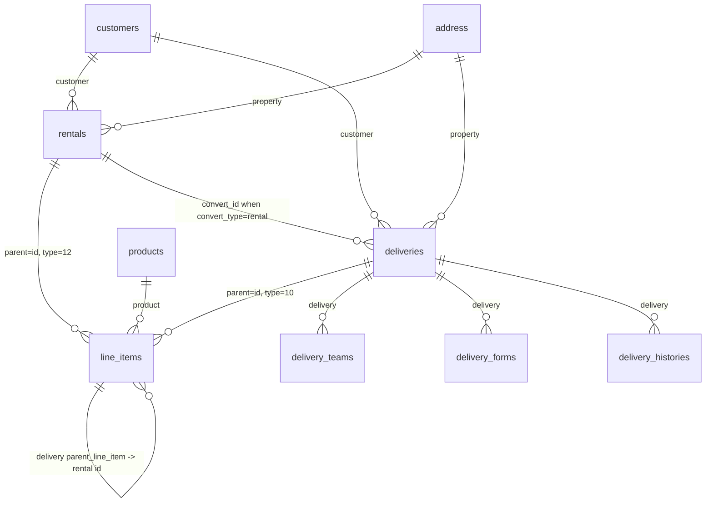
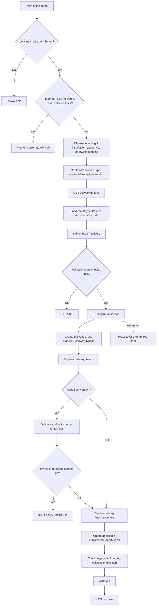

# Delivery Module and Rental-to-Delivery Conversion KT

This single document covers only Delivery and conversion of selected Rental line items into Delivery records. It is based on the current implementation. No application source code was changed.

## 1. Delivery overview and architecture

The module manages incoming, outgoing, and transfer delivery orders: customer/property/billing context, pickup and drop-off, schedule, drivers, line items, totals, tags, attachments, forms/signatures, status actions, and audit history.

### Frontend

- `frontend/src/router.js` — create, update, list, and detail routes for `delivery`, `incoming-delivery`, `outgoing-delivery`, and `transfer-delivery`.
- `frontend/src/view/pages/delivery/Delivery.vue` — listing shell.
- `frontend/src/view/pages/delivery/Delivery-Listing-Template.vue` — listing/filter/actions.
- `frontend/src/view/pages/delivery/Delivery-Detail.vue` — delivery detail and status actions.
- `frontend/src/view/pages/delivery/Delivery-Schedule.vue` and `Delivery-Team.vue` — schedule/team UI.
- `frontend/src/view/pages/delivery/components/BasicInformation.vue`, `ClientInformation.vue`, `ClientInformationNew.vue`, `Description.vue`, `TermsAndConditions.vue`, `InternalNotesAndAttachments.vue`, and `TeamMember.vue` — reusable sections.
- `frontend/src/view/pages/partials/Line-Item-V2.vue` — reusable line-item form.
- `frontend/src/core/services/store/delivery.module.js` — delivery state, options, available drivers, save, and detail API actions.
- `frontend/src/core/lib/delivery.lib.js` and `frontend/src/core/plugins/deliveryStatus.js` — reusable helpers/status presentation.

### Backend

- `app/Http/Controllers/DeliveryController.php` — `getOptions`, `updateOrCreateD1`, `getDeliveries`, `getDeliveryDetail`, `updateDeliveryStatus`, `orderDeliverOrFailed`, `deliveryForceClosed`, `deleteDelivery`, form/signature methods.
- `app/Traits/DeliveryTrait.php` — `traitCreateOrUpdateLineItemDelivery`, search/filter helpers, line persistence.
- `app/Models/Delivery.php` — `deliveries` model, fillable fields, casts, logging, and relations.
- `app/Models/DeliveryTeam.php`, `DeliveryForm.php`, `DeliveryHistory.php` — teams, forms, and audit records.
- `app/Models/LineItem/LineItem.php` — shared line-item model; delivery rows use `type = 10`.
- `app/Jobs/GenerateDeliveryPDF.php`, `DeliveryOrderPDF.php`, and `DeliveryExchangePDF.php` — PDF jobs.

No delivery repository, conversion-specific event/listener, or conversion-specific job was found. `CalculateParentDetails::dispatch(10, $delivery->id)` is dispatched from the line-item trait.

### Lifecycle

`POST delivery` creates a record; `PUT delivery/{id}` updates it. Creation sets `status = 1`, generates a barcode using type `117` incoming, `118` outgoing, or `119` transfer, and records `added_by/added_at`. `updateDeliveryStatus()` handles accepted/rejected/pickup and later workflow actions. The migration comments define `1 Open`, `2 Closed`, `3 Cancelled`; the controller also uses `11 Accepted` and checks `5 Rejected`. Canonical display text is in `statuses`.

`updateOrCreateD1()` validates, starts `DB::beginTransaction()`, creates/updates the header, replaces teams and delivery lines, writes tags/attachments, recalculates totals, then commits. Exceptions call `DB::rollBack()`, although the current catch block also calls `dd($err)`.

## 2. Database structure and relationships

| Table | Purpose | Important columns |
|---|---|---|
| `deliveries` | Delivery header | PK `id`; `barcode`, `type`, `status`, `customer`, `property`, `billing`, contact ids, `started_at`, `finished_at`, totals, `convert_type`, `convert_id`, `is_rental`, `project`, audit fields |
| `line_items` | Rental and delivery products | Delivery rows: `type=10`, `parent=deliveries.id`; rental rows: `type=12`, `parent=rentals.id`; linkage: `parent_line_item`, `parent_line_item_type`, `product`, `product_type`, `quantity`, `rate`, `total`, `equipment_serial_no` |
| `line_item_products` | Product-side line data | Delivery cleanup deletes `type=10` rows for the delivery |
| `line_item_properties` | Property allocation | `type`, `p_type`, `line_item`, `property`, `name` |
| `delivery_teams` | Delivery engineers/drivers | `delivery`, `engineer`, `user`, `engineer_active` |
| `delivery_forms` | Signed/transport form | `delivery`, `form_type`, `signatures`, customer/vehicle fields, `is_do_signed`, `pdf_url` |
| `delivery_form_history_drivers` | Form driver history | Related by `DeliveryForm` |
| `delivery_histories` | Delivery audit | `delivery`, `description`, `ip_address`, `attributes`, `added_by`, `added_at` |
| `rentals` | Rental header | PK `id`; `barcode`, `customer`, `property`, `billing`, `start_date`, `cease_date`, `status`, terms, totals, `installation_status` |
| `rental_histories` | Rental history | `rental`, description, attributes, actor/time fields |
| `products` | Product master | Barcode/image/category/brand/warranty lookup |
| `equipment` | Asset/equipment | Used for equipment lines and delivery-created equipment |
| `product_serial_numbers`, `product_serial_histories` | Serial inventory | Not written by the traced conversion save |
| `statuses` | Status dictionary | Rental status relation uses type `58`; delivery listing uses type `28` |

Relevant migrations: `database/migrations/2026_09_12_133718_create_table_delivery.php`, `2026_08_04_130000_add_delivery_workflow_columns.php`, `2026_10_16_100000_add_pdf_url_to_deliveries_table.php`, `2025_05_26_170304_create_rentals_table.php`, `2026_04_30_155730_create_rental_histories_table.php`, `2026_09_12_140422_create_delivery_forms_table.php`, `2026_09_12_140924_create_delivery_teams_table.php`, and `2026_09_15_161952_create_delivery_histories_table.php`.

`Delivery` belongs to customers, addresses, contacts, project, payment mode, users, and pickup address; has delivery line items filtered to `type=10`, tags, form, and related records. `Rental` belongs to customer/address/contact/users/status and has line items filtered to `type=12`. `DeliveryTeam` and `DeliveryHistory` belong to `Delivery`.



These are application-level joins; the migrations do not declare every relationship as an SQL foreign key.

## 3. Rental-to-Delivery conversion

There is no dedicated conversion endpoint. The process is a rental-page selection followed by ordinary delivery creation.

### Frontend trigger and selection

`frontend/src/view/pages/rental/Detail-Rental.vue::convertRentalToDelivery()` requires permission `delivery:create`, rental `status == 2`, at least one selected source line, and at least one line not fully delivered or returned. It blocks all-returned rentals, all-delivered rentals, and empty selections. It chooses `incoming` if `installation_status > 0`, otherwise `outgoing`, then routes to `incoming-delivery.create` or `outgoing-delivery.create` with:

```text
type=incoming|outgoing
convertType=rental
convertId=<rentals.id>
rentalLineItemIds[]=<selected line_items.id>
```

`frontend/src/view/components/RentalDeliveries.vue` displays existing rental deliveries. The frontend also uses `delivery_status = 2`, `returned_quantity`, and serialized return data when deciding whether conversion remains available.

### Prefill

`DeliveryController::getOptions()` validates `convertType`, `convertId`, and optional `lineItemIds`, loads `Rental`, then loads rental `line_items` with `parent = rental.id` and `type = 12`. It eager-loads product/equipment/property relations and normalizes:

- `parent_line_item = source line id`;
- `parent_line_item_type = 'rental'`;
- `product_id = product`;
- decoded `product = title`;
- `uom = quantity_type`;
- rate from `total / quantity` when possible;
- equipment barcode/serial/location or product barcode/image.

Customer, property, billing, and contact ids are also returned for prefill.

### Transaction sequence

`DeliveryController::updateOrCreateD1()` validates `oneoff`, line items, calculation data, and conversion fields; rejects inactive equipment; parses `oneoff.start_date/start_time` and `end_date/end_time`; rejects equal/reversed times; then calls `DB::beginTransaction()`.

It creates `deliveries` with `status=1`, barcode, conversion/header/date/amount data, logs a delivery history, replaces `delivery_teams`, validates and locks source rental lines with `lockForUpdate()`, rejects source lines already attached to another rental-origin delivery, deletes existing delivery `line_items` and `line_item_products`, calls `DeliveryTrait::traitCreateOrUpdateLineItemDelivery()`, recalculates totals, writes tags/attachments, and commits.

The backend rejects duplicate source ids in one request, verifies each source id belongs to the selected rental and has `type=12`, and checks other deliveries with the same `convert_type='rental'` and `convert_id`. Multiple deliveries per rental are supported when they contain different source lines. Validation and duplicate failures return HTTP 422; exceptions roll back and use the current generic 500 path.

### Line, product, asset, serial, and property handling

The trait writes delivery `line_items` with `type=10`, `parent=delivery.id`, product, title, item type, customer/property/contact context, quantity, uom, rate, discount, `product_type`, and `equipment_serial_no=serial_no`. It calculates `sub_total = rate * quantity`, line discount, and `total = sub_total - discount`.

For `is_equipment=1` and `type='product'`, it looks up `products` and creates an `equipment` row with customer, property, delivery id in `ticket`, product id, delivery line id, barcode, image, category, brand, and warranty values. A submitted property inserts `line_item_properties` with `type=3`.

The traced conversion code does not call a serial allocation service, update `product_serial_numbers`, or insert `product_serial_histories`; submitted serial text is stored in `equipment_serial_no`.

### Rental header, contracts, and history

The conversion save stores `deliveries.convert_type` and `deliveries.convert_id`. It does not update `rentals.status`, `start_date`, `cease_date`, contract records, or `rental_histories`. Rental progress is derived by `RentalTrait::get_rental_v1()`, which sums delivery quantities grouped by `parent_line_item` and compares them with rental quantities. `RentalController::getRentalDeliveries()` reads the same linkage.



## 4. Field mapping and business rules

| Rental source | Delivery destination | Transformation | Notes |
|---|---|---|---|
| `rentals.id` | `deliveries.convert_id` | integer | Used with `convert_type='rental'` |
| constant `'rental'` | `deliveries.convert_type` | direct | Origin marker |
| `rentals.customer` | `deliveries.customer` | integer | Prefill/submitted value |
| `rentals.property` | `deliveries.property` | integer | Prefill |
| `rentals.billing` | `deliveries.billing` | integer | Prefill where supplied |
| Rental contacts | Delivery contact columns | selected ids | Property/billing contact ids |
| Rental `line_items.id` | Delivery `parent_line_item` | integer | Source-line reference |
| constant `'rental'` | `parent_line_item_type` | direct | Valid source only |
| Rental `line_items.product` | Delivery `line_items.product` | payload `product_id` | Saved by trait |
| Rental `line_items.title` | Delivery line `title` | decoded/truncated to 250 chars | Display title |
| Rental `line_items.quantity` | Delivery `quantity` | integer cast | Submitted quantity is authoritative |
| Rental `line_items.quantity_type` | Delivery `quantity_type` | payload `uom` | Unit |
| Rental `line_items.total`, `quantity` | Delivery `rate` | `total / quantity` when possible | Otherwise submitted rate |
| Submitted `serial_no` | `equipment_serial_no` | direct text | No serial allocation here |
| Submitted `product_type`/`type` | Delivery `product_type`/`item_type` | direct/default | Product type defaults to goods |
| Submitted property object | `line_item_properties` | strips type prefix | Inserts `type=3` |
| `oneoff` schedule | `started_at`, `finished_at` | Carbon parse/format | Start before end |
| Rate, quantity, discount | `sub_total`, `discount`, `total` | calculated | `total=sub_total-discount` |

Rental title, remarks, terms, tax values, contract dates, and history are not automatically copied by this conversion save. Delivery dates use submitted `oneoff` values, not rental `start_date/cease_date`.

Rules verified in code:

- Frontend requires permission, rental status `2`, selected lines, and at least one unreturned/un delivered line.
- `installation_status > 0` selects incoming; otherwise outgoing.
- Source lines must belong to the rental and be type `12`.
- One source rental line can be linked to only one rental-origin delivery.
- Rental progress is the sum of delivery type-10 quantities grouped by `parent_line_item`.
- A line is complete when delivered quantity is at least rental quantity and rental quantity is positive.
- Rental status domain is `statuses.type=58`; delivery status display domain is `statuses.type=28`.
- Rental status `2` is active/approved in the frontend; status `4` or text `Returned` is returned.

Not verified in the conversion path: contract update, rental-history insert, rental-header status mutation, serial inventory allocation, and conversion-specific events/jobs.

## 5. APIs and code reference

| Method | Endpoint | Handler | Purpose |
|---|---|---|---|
| GET | `delivery/options` | `DeliveryController::getOptions` | Prefill, including rental lines |
| GET | `delivery/available-drivers` | `DeliveryController::getAvailableDriverV1` | Driver availability |
| GET | `deliveries` | `DeliveryController::getDeliveries` | Listing |
| POST | `delivery` | `DeliveryController::updateOrCreateD1` | Create/conversion |
| PUT | `delivery/{id}` | `DeliveryController::updateOrCreateD1` | Update |
| GET | `delivery/v1/{id}` | `DeliveryController::getDeliveryDetail` | Detail |
| PATCH | `delivery/{delivery}/status` | `DeliveryController::updateDeliveryStatus` | Status action |
| POST | `dropoff-delivery` | `DeliveryController::orderDeliverOrFailed` | Drop-off/failure |
| POST | `delivery-force-close/{delivery}` | `DeliveryController::deliveryForceClosed` | Force close |
| DELETE | `delivery/{delivery}` | `DeliveryController::deleteDelivery` | Delete |
| GET | `rental/{rental}/deliveries` | `RentalController::getRentalDeliveries` | Rental delivery list |
| GET | `delivery/delivery-order-form/{delivery}` | `DeliveryController::getDeliveryOrderForm` | Delivery form |
| PUT | `delivery/{delivery}/signature/update` | `DeliveryController::updateChecklistSignature` | Signature update |

`POST delivery` validates `oneoff`, `line-item`, and `calculation`; rental requests additionally use `convert_type`, `convert_id`, `parent_line_item`, and `parent_line_item_type`. Success returns the delivery through `success()`; validation/duplicate errors return JSON 422; exceptions use the generic 500 path.

| Functionality | File | Class/trait | Method |
|---|---|---|---|
| Prefill conversion | `app/Http/Controllers/DeliveryController.php` | `DeliveryController` | `getOptions` |
| Create/update | same | `DeliveryController` | `updateOrCreateD1` |
| Persist lines | `app/Traits/DeliveryTrait.php` | `DeliveryTrait` | `traitCreateOrUpdateLineItemDelivery` |
| Delivery status | `app/Http/Controllers/DeliveryController.php` | `DeliveryController` | `updateDeliveryStatus` |
| Rental progress | `app/Traits/RentalTrait.php` | `RentalTrait` | `get_rental_v1` |
| Rental delivery list | `app/Http/Controllers/RentalController.php` | `RentalController` | `getRentalDeliveries` |
| Frontend trigger | `frontend/src/view/pages/rental/Detail-Rental.vue` | Vue component | `convertRentalToDelivery` |
| Delivery frontend API | `frontend/src/core/services/store/delivery.module.js` | Vuex module | `CREATE_OR_UPDATE`, `GET_DELIVERY`, options action |

Quick reference: delivery line type `10`; rental line type `12`; delivery statuses documented as Open `1`, Closed `2`, Cancelled `3`, with accepted `11` and rejected check `5`; rental statuses use type `58`; delivery display statuses use type `28`; audit rows are in `delivery_histories`; Laravel logs are under `storage/logs`.

## 6. Troubleshooting

| Symptom | Investigation |
|---|---|
| Rental not available | Check `Detail-Rental.vue` permission/status/returned/delivered checks, `RentalTrait::get_rental_v1()`, and rental type-12 lines |
| Conversion returns 422 | Inspect response; verify type, oneoff formats, lines, calculation, conversion ids, and source ownership |
| Duplicate source-line error | Check repeated `parent_line_item` values and prior linked deliveries |
| Delivery absent | Inspect date checks, inactive equipment, transaction, `delivery_histories`, and `storage/logs` |
| Incorrect quantity/progress | Compare rental quantities with delivery type-10 quantities and `get_rental_v1()` aggregation |
| Serial mismatch | Compare submitted serial and `equipment_serial_no`; inspect serial tables separately because this endpoint does not allocate them |
| Asset mismatch | Check `product_type`, `is_equipment`, `product_id`, generated equipment, and `equipment.ticket` |
| Rental status unexpected | Conversion does not update `rentals.status`; inspect `RentalController::updateRentalStatus` separately |
| Rental history absent | Conversion writes delivery history, not rental history |
| Contract dates wrong | Compare rental `start_date/cease_date` with delivery oneoff dates; no contract update is performed |
| Duplicate delivery | Query `deliveries` by `convert_type='rental'`, `convert_id`, and source line ids; header uniqueness is not enforced |
| Partial conversion issue | Compare selected ids/quantities and recompute sums by `parent_line_item` |
| Team missing | Inspect `delivery_teams`; controller deletes old rows before recreating |
| Totals wrong | Inspect rate/quantity/discount, `update_parent_details`, and `CalculateParentDetails` |

## 7. Testing and safe change impact

No delivery-specific or rental-to-delivery test file was identified in the traced `tests` tree. Recommended scenarios are: normal single-line conversion; incoming selection; multiple products; partial and full conversion; multiple serial/equipment lines; property allocation; invalid rental status; missing data; duplicate source line; equal/reversed dates; forced failure and rollback; and rental-history preservation.

For changes:

- Adding a delivery field requires the delivery migration, `Delivery` fillable/casts/logging, `updateOrCreateD1`, Vue form/store, and detail/list queries.
- Changing mapping requires `getOptions`, `Detail-Rental.vue`, `DeliveryTrait::traitCreateOrUpdateLineItemDelivery`, line-item schema, and rental delivery listing.
- Changing eligibility requires frontend checks and backend source-line checks; server enforcement should be added for critical rules.
- Changing quantities requires `getOptions`, line-item UI, delivery trait calculations, `RentalTrait::get_rental_v1`, and `getRentalDeliveries`.
- Changing serial allocation requires the delivery trait plus serial models/tables and concurrency/rollback tests.
- Changing rental statuses requires `statuses` type 58, the Rental status relation, `RentalController::updateRentalStatus`, and frontend status checks.
- Changing validation requires `updateOrCreateD1`, frontend forms, and all incoming/outgoing/transfer callers.
- Changing contract date behavior requires explicit mapping and review of rental/contract code; it is not currently part of conversion.

Preserve the transaction, source-line validation, row locking, and duplicate checks. Do not use `convert_id` alone as a unique key because multiple deliveries for different lines of one rental are supported.

## 8. Verification boundaries

Verified: file paths, route handlers, model/table names, line-item types, conversion query parameters, source linkage, transaction boundaries, duplicate prevention, delivery calculations, progress aggregation, and frontend eligibility checks.

Not found in the conversion save path: rental-header status mutation, rental-history insert, contract update, serial inventory allocation, conversion-specific event/listener, or dedicated conversion API.
