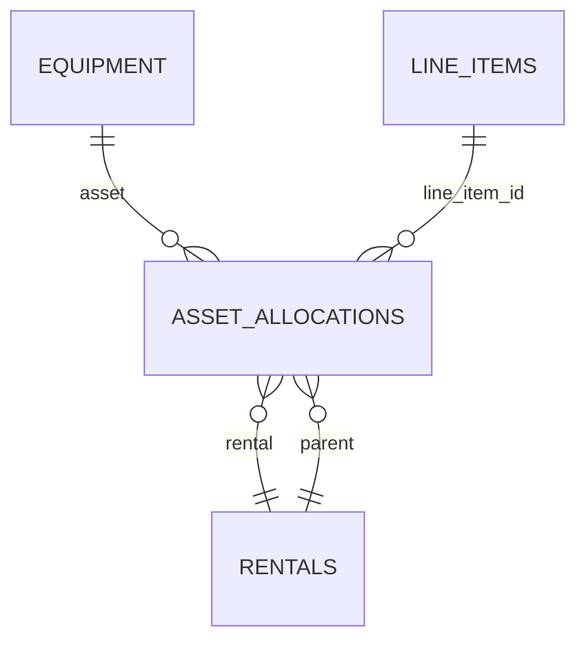
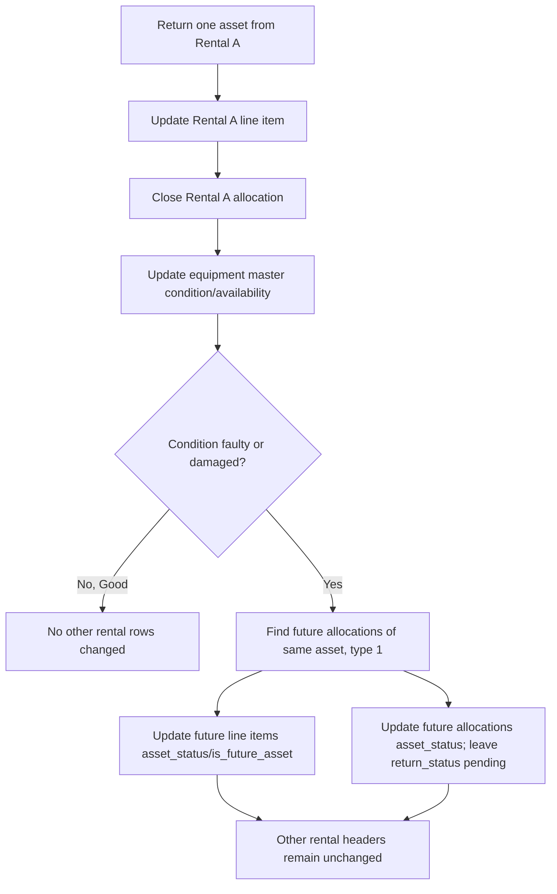

# Customer-owned asset, item page, and rental details

This document covers the customer/own-asset area that supplies assets to rentals. It is intentionally separate from the [Rental](/plasma/rental/overview) module because an asset has its own master record, status, warranty/details pages, allocations, and asset-specific rental history.

## 1. Terminology used by the code

The code uses similar names for different concepts:

| Concept | Code representation | Meaning in rental allocation |
|---|---|---|
| Own/customer-owned rental asset | `equipment.equipment_type = 'asset'` | A physical asset that can be allocated to a rental; `asset_allocations.type = 1`. |
| Customer equipment page | `client-equipment` UI, `EquipmentController`, `equipment` table | Customer-linked equipment master data. The page is routed and active. |
| Customer asset legacy page | `new-equipment-client/Asset.vue`, `Detail-Asset.vue` | Older asset listing/detail components using `asset` API paths. Current route/API availability is not verified and route listing shows no active `asset` endpoint. |
| Customer asset allocation | `asset_allocations.type = 2` | Allocation type documented by migration as customer asset; rental return logic described here primarily filters type `1`. |

Do not infer behavior from the display label alone. Rental code explicitly checks `product_type = 'asset'` and allocation `type = 1` for own-asset return/release behavior.

## 2. Active routed item pages

The current frontend router (`frontend/src/router.js`) exposes:

| Browser path | Route name | Component |
|---|---|---|
| `/client-equipment` | `admin.client-equipment` | `frontend/src/view/pages/equipment-client/Equipment.vue` |
| `/client-equipment/create` | `admin.client-equipment.create` | `frontend/src/view/pages/new-equipment-client/Create-Client-Equipment.vue` |
| `/client-equipment/update/:id` | `admin.client-equipment.update` | `Create-Client-Equipment.vue` |
| `/client-equipment/detail/:id` | `admin.client-equipment.detail` | `frontend/src/view/pages/equipment-client/Detail-Equipment.vue` |

The active list/detail pages use `equipment` API calls and require permission checks such as `client-equipment:view`, `client-equipment:create`, and `equipment:update`.

## 3. Asset list page behavior

### `frontend/src/view/pages/equipment-client/Equipment.vue`

This is the active customer-equipment listing component. Its key data values are `routeAPI: 'equipment'`, `routeName: 'client-equipment'`, `routeDetailName: 'client-equipment.detail'`, and `filter_type: 'main_customer'`.

### List controls and buttons

| UI control | Handler/API | Effect |
|---|---|---|
| Status filter | Listing mixin and `getRows()` | Sends listing filters; backend accepts `all`, `active`, `inactive`, `faulty`, `retired`, `damaged`, `good`, and `repaired`. |
| Customer/company selector | `filter_type` | Uses `main_customer` for the customer-equipment view. |
| Search/filter drawer | Listing mixin | Filters by searchable equipment fields and customer/property values. |
| Create | `getDefaultRoute('client-equipment.create')` | Opens `Create-Client-Equipment.vue`; requires `client-equipment:create`. |
| Edit | Row/detail route | Opens update form; requires `equipment:update`. |
| Row click | Listing mixin/detail route | Opens `client-equipment.detail`. |
| Bulk active | `updateEquipmentStatus(1)` | `PATCH /api/equipments/status` with selected equipment IDs and `status = 1`. |
| Bulk inactive | `updateEquipmentStatus(0)` | Same endpoint with `status = 0`. |
| Import | Present in list menu where enabled | The active routed customer-equipment page exposes import UI paths; exact import endpoint for this page is **Not verified**. |
| Delete row | `open_delete_dailog(row)` | Shows delete dialog; backend bulk delete is `DELETE /api/equipment` with `ids[]`. |
| Warranty | `ManageWarranty` / warranty dialogs | Creates/updates warranty data through warranty/product APIs; exact customer-asset button flow is **Not verified**. |

The backend listing method is `EquipmentController::getEquipments()`, which validates status/filter inputs, calls listing helpers, returns rows, status list, headers, searchable fields, pagination, and counts.

## 4. Item detail page

### `frontend/src/view/pages/equipment-client/Detail-Equipment.vue`

The detail page calls `GET /api/equipment/{equipment}` through `getEquipmentDetail()`. The backend method `EquipmentController::getEquipment()` loads the equipment with customer, default person, property/contact, warranty, preventive maintenance, supplier, tags, location, creator, and updater relationships, then appends `more_actions`.

The detail page displays or links to:

- Basic item information from `detail/BasicOverview.vue`: customer asset number/barcode, asset name, serial number/QR, selling price, customer/company.
- Dates: installation, commission/activation, and end-of-life.
- Location, address, tags, specifications, brand, category, and description.
- Customer asset sales information from `detail/Overview.vue`: salesperson, supplier, purchase date, and purchase price.
- Warranty tab (`detail/Warranty.vue`) when warranty permission/data is present.
- Job, quotation, invoice, preventive maintenance, visit, and image tabs subject to permissions.

### Detail page buttons

| Button/action | Handler | Effect |
|---|---|---|
| Edit | Router to `client-equipment.update` | Opens the customer-equipment update form. |
| Back | `goBack()` | Returns to previous page. |
| Mark active | `patchEquipmentParams(1, action)` | `PATCH /api/equipments/status`, sets selected equipment active. |
| Mark inactive | `patchEquipmentParams(0, action)` | Same endpoint, sets `activated = 0`. |
| Mark faulty | `faultyDialog`, then status action | Backend sets `faulty = 1`, `activated = 0`, `status = 5`, and syncs active future rental line items to asset status `5`. |
| Mark repaired | `repairedDialog`, then status action | Backend clears faulty/retired flags, sets `activated = 1`, `status = 3`, and syncs future rental allocations with asset status `0`. |
| Mark damaged | `faultyDialog` with “Mark as Damaged” | Backend sets `status = 4`, `activated = 0`, clears faulty/retired flags, and syncs future rental line items to asset status `4`. |
| Mark retired | `retireDialog`, then status action | Backend sets `retired = 1`, `activated = 0`, `status = 2`, and syncs future rental allocations to asset status `4`. |
| Mark not retired | `patchEquipmentParams(1, action)` | Backend clears faulty/retired flags, sets `activated = 1`, `status = 1`, and syncs future allocations to asset status `0`. |

The detail page hides the “More” menu if `detail.status` is `2` or `4`. Individual action visibility is transformed from the API's `more_actions` based on current `activated`, `faulty`, and `retired` values.

## 5. Backend equipment APIs

Routes are defined in `routes/api.php` under JWT authentication:

| Method | Endpoint | Controller method | Purpose |
|---|---|---|---|
| GET | `/api/equipment` | `EquipmentController::getEquipments` | List/filter equipment. |
| POST | `/api/equipment` | `updateOrCreate` | Create equipment. |
| PUT | `/api/equipment/{equipment}` | `updateOrCreate` | Update equipment. |
| GET | `/api/equipment/{equipment}` | `getEquipment` | Detail record and related data. |
| PATCH | `/api/equipment/{equipment}` | `updateParticularField` | Particular-field update; implementation is currently an empty method in `EquipmentController`. |
| DELETE | `/api/equipment` | `deleteEquipments` | Deletes IDs supplied as `ids[]`. |
| GET | `/api/equipment/options` | `getOptions` | Equipment options/tags. |
| PATCH | `/api/equipments/status` | `updateStatusEquipment` | Active/inactive/faulty/repaired/damaged/retired state changes. |
| GET | `/api/get-rentals/{equipment}` | `getAssetsRental` | Rental allocations/history for one own asset. |
| GET | `/api/equipment/warranty` | `getAllWarrantyOfEquip` | Equipment warranty listing. |
| GET | `/api/equipment/visits/{id}` | `getAllVisitsOfEquip` | Related visits. |
| GET | `/api/equipment/preventive-maintenances` | `getAllPmsOfEquip` | Preventive-maintenance data. |

`GET /api/get-rentals/{equipment}` validates `status`, `filterDate`, `rental_status`, `condition`, `return_status`, `exclude_rental_id`, pagination, and returns allocation rows with linked line item and rental data. It filters `asset_allocations.type = 1`, so it is the asset-specific rental view relevant to own rental assets.

## 6. Asset-specific rental details page

The current routed `Detail-Equipment.vue` does not itself expose a separate `get-rentals/{equipment}` call in the inspected code. The backend endpoint exists and is intended to provide the asset's rental details. The consuming UI is **Not verified** in the current route/component state; search for `get-rentals/` before adding a new tab.

The endpoint's returned rental detail includes:

- Allocation: `asset`, `parent`, `line_item_id`, `type`, `start_date`, `cease_date`, `activated`, `return_status`, `asset_status`.
- Line item: `id`, `type`, `product`, `parent`, `is_asset_replaced`, `source_line_item_id`, `asset_status`, `remarks`.
- Rental: `id`, `barcode`, `customer`, `date`, `contract_end`, `open_till`, `property`, `status`, plus a derived `rental_status` object.
- Customer barcode and property relationship.

Supported filters:

| Filter | Values | Meaning |
|---|---|---|
| `status` | `all`, `active`, `inactive` | Filters the master equipment activation state. |
| `filterDate` | boolean-like | When true, only future/current allocation dates are selected. |
| `rental_status` | `0`, `4`, `5`, `6`, `7`, `10` | Filters linked rental header status. |
| `condition` | `all`, `0`, `4`, `5`, `good` | Filters line-item asset condition/status. |
| `return_status` | `all`, `pending_return`, `returned` | Filters allocation return state. |
| `exclude_rental_id` | positive integer | Excludes one parent rental, useful while selecting an asset for that rental. |

## 7. Asset master record and persistence

The model is `App\Models\Equipment\Equipment`, table `equipment`. Relevant fields include:

- Identity: `id`, `barcode`, `barcode_image`, `name`, encrypted `serial_no`, `serial_image`.
- Ownership/linkage: `equipment_type`, `main_type`, `customer`, `property`, `product`, `supplier`, `location`, `site_location`.
- State: `activated`, `status`, `faulty`, `retired`, `faulty_remark`, `retired_remark`.
- Commercial/detail: selling/purchase price and dates, brand, model, category, specification, description.
- Audit: `added_by`, `added_at`, `updated_by`, `updated_at`.

`EquipmentController::updateOrCreate()` creates or updates the master record, generates a barcode, can create warranty records and uploaded documents, updates tags, and writes equipment activity. The exact validation list is large and should be read from the method before adding a field.

## 8. Allocation model and database

`App\Models\AssetAllocation` represents `asset_allocations`. The migration is named `2026_06_23_113157_create_customer_asset_allocations_table.php` even though it creates the `asset_allocations` table.

Important columns:

| Column | Purpose |
|---|---|
| `asset` | Equipment ID. |
| `parent` | Parent rental ID in the rental flow. |
| `line_item_id` | Rental line-item ID. |
| `type` | Migration comment: `1` own asset, `2` customer asset. |
| `start_date`, `actual_start_date`, `cease_date` | Allocation period. |
| `activated` | Whether allocation is active. |
| `asset_status` | Condition/state propagated from return or equipment status actions. |
| `return_status` | `1` means returned in the return logic. |
| `return_date`, `return_cease_date` | Return timing. |
| `added_by`, `added_at`, `updated_by`, `updated_at` | Audit fields. |

Model relationships are `lineItem()` and `rental()`. No foreign keys are declared in the shown allocation migration.

## 9. Return-condition effects from rental back to the asset page

The rental return endpoint is `RentalController::bulkReturnItems()` at `POST /api/rental/bulk-return-items`.

| Return condition | Selected line item | Selected allocation | Equipment master | Future other rental allocations |
|---|---|---|---|---|
| Good | `asset_status = 1`, `is_future_asset = 0`, remarks saved | `activated = 0`, `asset_status = 1`, `return_status = 1`, return date saved | `activated = 1`, `status = 1` | No propagation. |
| Faulty | `asset_status = 5`, `is_future_asset = 0`, remarks saved | Same return fields with status `5` | `activated = 0`, `status = 5` | Matching future type-1 allocations get status `5`, `return_status = null`; their line items get `asset_status = 5`, `is_future_asset = 1`. |
| Damage/Damaged | `asset_status = 4`, `is_future_asset = 0`, remarks saved | Same return fields with status `4` | `activated = 0`, `status = 4` | Matching future type-1 allocations get status `4`, `return_status = null`; their line items get `asset_status = 4`, `is_future_asset = 1`. |

The current rental header status is not changed by item return. Other rental header statuses are not changed either. The cross-rental propagation is limited to future allocations with the same equipment ID, `type = 1`, start date at/after the current time, and a current/non-expired cease date. `return_quantity` is currently logged in activity attributes but is not used to split or partially return a line-item quantity.

## 10. Equipment status actions also affect future rentals

`EquipmentController::updateStatusEquipment()` handles the item detail/list active-state buttons. For `mark_as_faulty`, `mark_as_damaged`, `mark_as_retired`, `mark_as_repaired`, and `mark_as_not_retired`, it calls `syncActiveRentalLineItemStatuses()`.

That helper finds future active allocations for the selected equipment where `type = 1` and `return_status` is not `1`. It updates their allocation `asset_status`, clears `return_status`, and updates type-9 line items. When repaired/not retired, status `0` is also accompanied by `is_future_asset = 0`; faulty/damaged/retired statuses do not clear that flag.

Therefore there are two ways an asset condition can propagate into future rentals:

1. Return a rental item as faulty/damaged through `RentalController::bulkReturnItems()`.
2. Mark the equipment master faulty/damaged/retired/repaired through `EquipmentController::updateStatusEquipment()`.

Neither path changes the other rental's header `rentals.status`.

## 11. Legacy/unwired asset pages

`frontend/src/view/pages/new-equipment-client/Asset.vue` and `Detail-Asset.vue` use `routeAPI: 'asset'` and calls such as `GET asset/{id}`, `PATCH asset`, `GET asset-count`, `POST asset/import`, and `PATCH single-customer/{activated}/{id}`. Current `routes/api.php` does not contain active `asset`, `asset-count`, `asset/import`, or `single-customer` routes in the route list; `php artisan route:list --path=asset` showed only rental asset and settings routes. Treat these components as legacy/unwired until verified in the target deployment.

## 12. Debugging checklist

When an asset is missing or incorrectly shown in a rental:

1. Check `equipment.id`, `equipment.equipment_type`, `activated`, `status`, `faulty`, and `retired`.
2. Check the rental line item: `type = 9`, `parent`, `product`, `product_type`, `asset_status`, `is_future_asset`, and `remarks`.
3. Check `asset_allocations` by `asset`, `parent`, `line_item_id`, `type`, date range, `activated`, `asset_status`, and `return_status`.
4. Compare `GET /api/get-rentals/{equipment}` output with the detail page `GET /api/equipment/{equipment}` output.
5. Check `rental_histories` and equipment activity for return/status actions.
6. Check `RentalController::bulkReturnItems()` for return-condition propagation and `EquipmentController::syncActiveRentalLineItemStatuses()` for master-status propagation.
