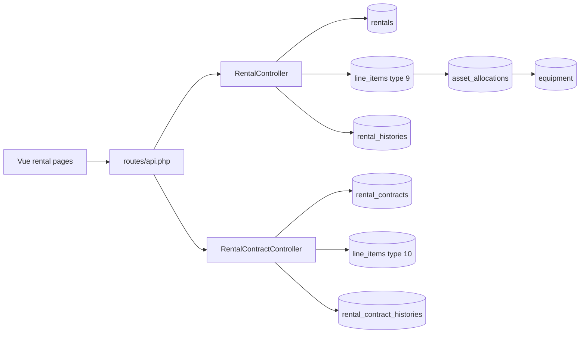

# Rental architecture and dependencies

The rental feature has two records: `rentals` (`App\Models\Rental\Rental`) and `rental_contracts` (`App\Models\Rentalcontract`). The main controllers are `app/Http/Controllers/RentalController.php` and `app/Http/Controllers/RentalContractController.php`.

## Dependency chain

Important shared dependencies are `customers`, `customer_persons`, addresses, products, equipment, projects, invoices, tickets, visits, `transaction_documents`, `serial_number_items`, and `asset_allocations`.

The controllers use `RentalTrait`, `RentalContractTrait`, `LineItemTrait`, `DocumentTrait`, `PDFTrait`, `MailTrait`, `ActivityTrait`, `ProductTrait`, `InvoiceTrait`, and `EnquiryTrait`. `frontend/src/main.js` initializes the Vue app, API service, Vuex, router, JWT verification, and feature flags.

## UI entry points

- `frontend/src/view/pages/rental/Rental.vue`: listing.
- `frontend/src/view/pages/rental/Create-Rental.vue`: create/update form.
- `frontend/src/view/pages/rental/Detail-Rental.vue`: detail/actions.
- `frontend/src/view/pages/rental-contract/Rental-Contract.vue`: contract listing.
- `frontend/src/view/pages/rental-contract/Rental-Create-Contract.vue`: contract form.
- `frontend/src/view/pages/rental-contract/Rental-Detail-Contract.vue`: contract detail.
- `frontend/src/view/components/RentalLineItem.vue`, `RentalLineItemDialog.vue`, and `Serial-Number-Rental-Dialogue.vue`: reusable item/asset controls.

## Important dependency rule

Rental own-asset allocation uses `equipment.equipment_type = 'asset'`, `asset_allocations.type = 1`, and rental line-item `type = 9`. Customer equipment/customer-asset allocation is a different path. See the [Customer-Owned Assets module](/plasma/customer-owned-assets/overview).

