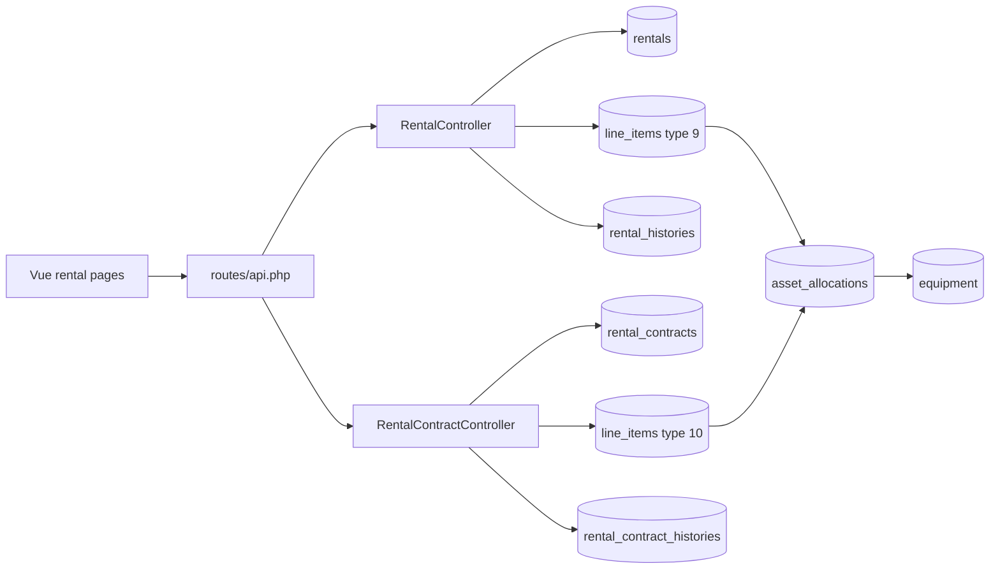
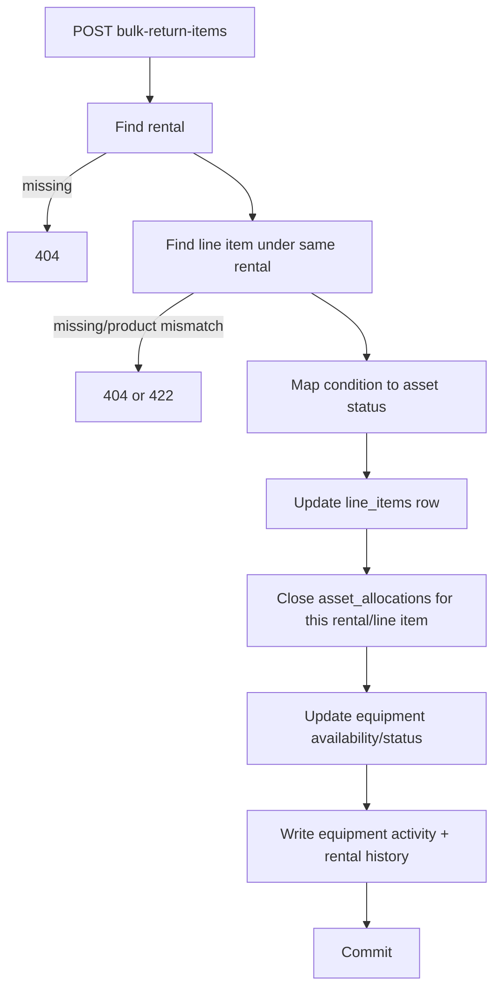

# Rental module: complete developer KT

This is the single KT document for the rental module. It describes the current checked-out implementation, including page buttons, API calls, dependencies, statuses, asset return behavior, and the effect of returning one asset on other rentals that use the same asset. Source paths and method names are included so a developer can trace every behavior.

Related module: [Customer-Owned Assets](/plasma/customer-owned-assets/overview).

> **Scope note:** This document describes what the code currently does. Where the UI, migration comments, model comments, and scheduler disagree, the discrepancy is called out. It does not expose credentials or secret values.

## 1. Module map

The rental feature has two related records:

| Area | Table | Model | Main controller | Main UI |
|---|---|---|---|---|
| Rental transaction | `rentals` | `App\Models\Rental\Rental` | `app/Http/Controllers/RentalController.php` | `frontend/src/view/pages/rental/` |
| Rental contract | `rental_contracts` | `App\Models\Rentalcontract` | `app/Http/Controllers/RentalContractController.php` | `frontend/src/view/pages/rental-contract/` |

Shared dependencies are:

- `line_items`: rental line items use type `9`; rental-contract line items use type `10` in the contract controller.
- `asset_allocations`: date-based allocation of customer-owned assets and asset status.
- `serial_number_items`: serialized item links copied during contract conversion.
- `transaction_documents`: attachments; rental documents are queried with document type `2`.
- `customers`, `customer_persons`, `addresses`, `products`, `equipment`, `projects`, `invoices`, `tickets`, and `ticket_visits`.
- Traits: `RentalTrait`, `RentalContractTrait`, `LineItemTrait`, `DocumentTrait`, `PDFTrait`, `MailTrait`, `ActivityTrait`, `ProductTrait`, `InvoiceTrait`, and `EnquiryTrait`.

Customer-owned asset behavior is documented separately in `docs/KT/CUSTOMER-OWN-ASSET-KT.md`. In this module, the important distinction is that rental-owned/customer-owned assets are represented by `equipment.equipment_type = 'asset'` and allocation `type = 1`; customer equipment is a separate equipment category and is not the same as a rental own-asset allocation.



## 2. Frontend pages and route names

Routes are defined in `frontend/src/router.js`:

| Browser path | Route name | Component |
|---|---|---|
| `/rental` | `admin.rental` | `frontend/src/view/pages/rental/Rental.vue` |
| `/rental/create` | `admin.rental.create` | `Create-Rental.vue` |
| `/rental/update/:id` | `admin.rental.update` | `Create-Rental.vue` |
| `/rental/detail/:id` | `admin.rental.detail` | `Detail-Rental.vue` |
| `/rental-contract` | `admin.rental.contract` | `rental-contract/Rental-Contract.vue` |
| `/rental-contract/create` | `admin.rental.contract.create` | `Rental-Create-Contract.vue` |
| `/rental-contract/update/:id` | `admin.rental.contract.update` | `Rental-Create-Contract.vue` |
| `/rental-contract/detail/:id` | `admin.rental.contract.detail` | `Rental-Detail-Contract.vue` |

`frontend/src/main.js` initializes Axios/API services, Vuex, router auth checks, Vuetify, and feature flags. `frontend/src/core/services/api.service.js` and `frontend/src/core/services/store/request.module.js` are the normal request path.

## 3. Rental page buttons and what they do

### Listing page: `Rental.vue`

The listing page checks `getPermission('rental:view')`. The visible controls include:

| UI control | Code path | Effect |
|---|---|---|
| Create Rental | `getDefaultRoute('rental.create')` | Opens the create form. Requires `rental:create`. |
| Status selector | `status`, `statusList` | Reloads/filter listings by status. Counts come from listing response data. |
| Filter/search | `searchDialog = true` | Opens search criteria; searchable fields come from the model/controller configuration. |
| Column editor | `defaultColDefs`, `updateVisible()` | Changes visible/sortable listing columns in the browser state. |
| Row click | `rowClicked(data)` | Opens `admin.rental.detail` for the selected record. |
| More actions | `moreAction(...)` / inherited listing mixin | Export, refresh, and row/bulk actions. Exact available actions depend on the response's `actions` field and permission checks. |

The active listing API is `GET /api/rental`, handled by `RentalController::getRentals()`.

### Detail page: `Detail-Rental.vue`

`RentalController` returns action metadata through `Rental::getMoreActionsAttribute()` / `getMoreNewActionsAttribute()`. The detail component dispatches actions through `updateMoreAction(type)`.

| Button/action | Frontend handler | Backend/API effect |
|---|---|---|
| Edit | `editQuotation()` | Routes to the update form; the form later sends `PATCH /api/rental/{rental}`. |
| Revise | `reviseQuotation()` | Creates a revised version if the active action path exposes it. Exact route behavior is **Not verified** for current rental UI. |
| Convert to visit | `routeToJob()` | Routes toward job/visit conversion. The exact rental API call is **Not verified** in the inspected action block. |
| Signature link | `getSignatureLink()` | Calls `GET /api/rental/{id}/signature-link`; route presence in the current `routes/api.php` should be rechecked before relying on it. |
| Convert invoice | `routeToInvoice()` | Routes toward invoice conversion; exact active backend call is **Not verified**. |
| Duplicate | `routeToDuplicate()` | Uses duplicate flow; the API route for rental duplicate is not present in the rental route block inspected. **Not verified.** |
| Re-quote | `requoteQuotation()` | Re-quote flow; exact API mapping is **Not verified**. |
| Send as email | `mail_dialog = true` | Opens mail dialog. Rental-specific mail routes/methods exist in the controller, but the exact current page request is **Not verified**. |
| Mark approved | confirmation then `updateStatus('mark_as_approved')` | `PATCH /api/rental/{id}/status`, status becomes `6`; stores approval remark, approver, and approval date. |
| Mark rejected | confirmation then `updateStatus('mark_as_rejected')` | Same status endpoint; status becomes `4`, stores rejection remark/type, releases own assets. |
| Mark cancelled | confirmation then `updateStatus('mark_as_cancelled')` | Same endpoint; implementation also writes status `4` and rejection metadata, then releases own assets. It does not write a distinct cancelled status. |
| Mark terminated | confirmation then `updateStatus('mark_as_terminated')` | Same endpoint; status becomes `7`, stores `remarks`, releases own assets. |
| Pending/accepted/sent/unapproved | `updateStatus(...)` | The UI has handlers for these action names, but `RentalController::updateRentalStatus()` validates only `mark_as_terminated`, `mark_as_rejected`, `mark_as_approved`, and `mark_as_cancelled`. Calling the unsupported names returns 422. |
| Delete | `deleteVisit()` from `mark_as_delete` | Delete action is present in UI/model action code for some statuses, but the exact active rental route is **Not verified**. |
| Download PDF | `downloadPDFNew()` | Current code builds a `quotation/{id}/pdf/download/{template}` URL, while rental-specific controller PDF methods also exist. Confirm route before changing this. |
| Print | `printPDF()` | Opens/prints PDF; exact active URL is **Not verified**. |

### Create/update form: `Create-Rental.vue`

The form handles customer, property, billing address, contact persons, title, descriptions, rental type, contract flag, start/cease dates, validity, sales/prepared-by users, terms, discounts/tax, attachments, and line items. It calls:

- `GET /api/rental/options/{rental?}` to load form options.
- `POST /api/rental` for creation.
- `PATCH /api/rental/{rental}` for update.

The form has a contract switch and date controls. It prevents a start date later than the end date in the client. Backend validation remains authoritative.

### Rental-contract listing/form/detail

`Rental-Contract.vue`, `Rental-Create-Contract.vue`, and `Rental-Detail-Contract.vue` provide the equivalent contract UI. The contract listing has export, refresh, status filtering, column selection, and bulk status actions. Its `updateBulkAction()` sends status numbers through the contract bulk endpoint; inspect `Rental-Contract.vue` before changing those mappings because the UI's status labels do not match all migration comments.

## 4. API map

All routes listed here are in the JWT-protected group in `routes/api.php` unless explicitly stated.

### Rentals

| Method | Endpoint | Method | Main side effects |
|---|---|---|---|
| GET | `/api/rental` | `RentalController::getRentals` | Reads rentals, filters, counts, relationships. |
| GET | `/api/rental/{rental}` | `getRental` | Reads one rental and related data. |
| GET | `/api/rental/options/{rental?}` | `getOptions` | Reads settings/reference data. |
| POST | `/api/rental` | `updateOrCreateV1` | Creates rental, line items, documents, allocations, totals/history. |
| PATCH | `/api/rental/{rental}` | `updateOrCreateV1` | Updates rental and related data. |
| PATCH | `/api/rental/{rental}/status` | `updateRentalStatus` | Changes lifecycle state, writes history, may release assets. |
| PATCH | `/api/convert-contract/{contract}` | `convertContract` | Copies contract to a new rental, line items, documents, relations, and allocations. |
| POST | `/api/rental/bulk-return-items` | `bulkReturnItems` | Returns one submitted item payload; despite the name, the current code processes one `items` object. |
| GET | `/api/get-assets/{parent}` | `getLineItems` | Reads rental line/asset data. |
| POST | `/api/add-rental-asset` | `updateLineItems` | Adds or updates rental asset line items. |
| GET | `/api/setting/rental` | `SettingController::getRental` | Reads rental settings. |

### Rental contracts

`GET/POST /api/rental-contract/{contract}/send-mail`, `GET/POST/PUT/DELETE/PATCH /api/rental-contract`, `GET /api/rental-contract/{contract}`, `GET /api/rental-contract/options/{contract?}`, `GET /api/rental-contract/status`, `GET /api/rental-contract/duplicate/{contract}`, `PATCH /api/rental-contract/{contract}/status`, `GET/PUT/DELETE /api/rental-contract/{contract}/line-item`, and `GET /api/rental-contracts-show-by-days` map directly to the methods in `RentalContractController` listed in `routes/api.php`.

## 5. Rental status behavior

`RentalController::updateRentalStatus()` validates action strings, not numeric status values:

| Request `status` | Database changes | Asset effect | History |
|---|---|---|---|
| `mark_as_approved` | `rentals.status = 6`, approval remark/type, `approved_by_id`, `approved_date` | No release | Creates `rental_histories` row. |
| `mark_as_rejected` | `status = 4`, `approved_reject_remarks`, `remark_type = rejected` | Releases own assets for this rental | Creates history. |
| `mark_as_cancelled` | Also writes `status = 4`, rejection fields | Releases own assets | History description says marked as rejected. |
| `mark_as_terminated` | `status = 7`, `remarks` | Releases own assets | Creates history. |

`CloseRentalsPastCeaseDate::handle()` runs daily at `00:30` and writes status `10` for rows with `contract_end` before today. For rentals, it also calls `RentalTrait::releaseRentalOwnAssets()` and creates a system history row. The migration comment for `rentals.status` says `1 Draft, 2 Accepted, 3 Rejected, 4 Pending, 5 Sent, 6 Cancelled, 7 Closed`, while the frontend `frontend/src/view/pages/rental/constants.js` maps `4 Rejected, 5 Draft, 6 Approved, 7 Terminated, 10 Closed`. This is a verified inconsistency.

## 6. Exact return process

The return endpoint is `POST /api/rental/bulk-return-items`, handled by `RentalController::bulkReturnItems()`.

### Request shape currently expected

The controller expects a rental ID and an `items` object. It accepts JSON-string `items` and decodes it. Required/optional fields in the validator are:

```json
{
  "rental_id": 123,
  "items": {
    "line_item_id": 456,
    "project_line_item_id": 789,
    "product_id": 999,
    "product_type": "asset",
    "return_quantity": 1,
    "return_date": "2026-11-19",
    "remarks": "Returned in good condition",
    "condition": "Good",
    "attachment_keys": []
  }
}
```

The code validates `items.line_item_id`, `items.return_date`, `items.remarks`, and `items.condition`; accepted condition strings include `Good`, `Faulty`, `Damage`, and `Damaged` in case variants. `attachment_keys` is validated but is not persisted by this method. `return_quantity` is recorded in the equipment activity attributes but is not used to partially reduce quantity in the inspected method. This means the current implementation returns the selected line-item allocation, not a quantity-specific allocation; verify this before implementing partial returns.

### Step-by-step database behavior

1. Load the parent `Rental` by `rental_id`; missing parent returns 404.
2. Load the `LineItem` by `line_item_id` and require `line_items.parent = rental_id`; mismatch returns 404.
3. Read the product from the line item. A non-positive product returns 422.
4. If request `product_id` is present, it must equal the line item's product.
5. Convert condition to an internal asset status:
   - Good => `asset_status = 1`, equipment `activated = 1`.
   - Faulty => `asset_status = 5`, equipment `activated = 0`.
   - Damage/Damaged => `asset_status = 4`, equipment `activated = 0`.
6. Update the selected line item: `asset_status`, `is_future_asset = 0`, `remarks`, `updated_by`, and `updated_at`.
7. Update all `asset_allocations` for the selected `line_item_id` and current rental: `activated = 0`, `asset_status`, `return_status = 1`, `return_date`, `updated_by`, and `updated_at`.
8. Load the `Equipment` by the submitted `product_id` and update its `activated`, `status`, `updated_by`, and `updated_at`.
9. Write equipment activity and a `rental_histories` record.
10. Commit the transaction and return success. On exception, roll back and return 500.



## 7. What returning one rental does to other rentals using the same asset

### Good return

For `Good`, the code updates only:

- the selected rental line item;
- allocations for that line item under the selected rental;
- the equipment row for the returned asset;
- activity/history for the selected rental/equipment.

It does **not** query or update other rental parents for a good return. Other future rentals keep their existing line-item/allocation statuses. The equipment is set available with `activated = 1` and `status = 1`, subject to the direct `Equipment::update()` call.

### Faulty or damaged return

For `Faulty`, `Damage`, or `Damaged`, the code additionally searches `asset_allocations` for the same asset where:

- allocation `type = 1`;
- `parent != current rental`;
- `start_date >= now()`;
- `cease_date >= now()` or is null;
- related line item has `type = 9`.

Every matching future line item is updated to the same `asset_status` and `is_future_asset = 1`. Its active asset allocation is updated with the same `asset_status` and `return_status = null`. This is the cross-rental effect.

The current rental's status is **not** changed by item return. The other rental records' `rentals.status` are also **not** changed. Only their matching line-item and allocation asset state is changed. The other rental's equipment-level availability can also be affected because the selected equipment row is set to inactive (`activated = 0`) with status `4` or `5`.

### Important limitation

The conflict search only covers future allocations meeting the date and type filters. It does not update every historical/current rental using the same asset. It also does not change rental header statuses. Whether the UI hides, blocks, or warns on affected future rentals is **Not verified**; inspect `RentalLineItem.vue`, `RentalLineItemDialog.vue`, and `Serial-Number-Rental-Dialogue.vue` before changing the user experience.

For the asset item page and the rental-history view for one asset, see the separate customer-owned asset document. The backend route that provides an asset's rental history is `GET /api/get-rentals/{equipment}`, handled by `EquipmentController::getAssetsRental()`; it filters allocation rows by asset ID and allocation type `1`, and returns the linked rental barcode, customer, property, dates, rental status, line-item condition, and return status.

## 8. Termination/rejection versus item return

`RentalController::releaseRentalOwnAssets()` is used by rejection, cancellation, termination, and scheduled expiry. It finds type `9` line items for the rental whose `product_type = asset`, then updates their type-1 allocations to inactive/returned and sets the equipment back to active/status `1` unless equipment status is in `[2,4,5]`.

This differs from `bulkReturnItems()`:

- status actions release all qualifying own-asset allocations for the rental;
- item return processes one line item payload;
- item return records condition and can mark equipment faulty/damaged;
- status release does not take a condition payload and generally restores equipment availability.

## 9. Contract conversion and dependencies

`RentalController::convertContract()` locks the source `Rentalcontract`, copies shared columns into a new `Rental`, generates a new barcode, sets `is_contract = 1`, `is_from_contract = 1`, `rental_contract = source contract ID`, and `status = 1`. It replicates contract line items as rental type `9`, copies transaction warranties, line-item products, serialized item links, asset allocations, and documents, then recalculates parent totals.

Because conversion copies asset allocations, a later return on the new rental acts on the copied rental allocation parent/line item, not the original contract line item. Always inspect both source and target allocation rows when debugging conversion.

## 10. Database and model reference

### `rentals`

Migration: `database/migrations/2026_05_22_110929_create_rental_table.php`, with additions in `2026_07_15_140139_add_columns_to_rentals.php` and `2026_07_17_130312_add_remarks_to_rentals.php`.

Key fields: `barcode`, customer/address/contact IDs, `status`, `contract_start`, `contract_end`, `duration`, `rental_type`, `is_contract`, `rental_contract`, `is_from_contract`, `project_id`, totals/discount/tax fields, signature fields, conversion flags, and audit timestamps. `project_id` explicitly references `projects.id`; most other IDs are application relationships.

Important `Rental` relationships include `customer()`, `property()`, `billing()`, `property_person()`, `billing_person()`, `project()`, `line_items()`, `documents()`, `rentalContract()`, `tags()`, and user relations. Search and action metadata are in `scopeSearch()`, `scopeListing()`, `getMoreActionsAttribute()`, and `getMoreNewActionsAttribute()`.

### `rental_contracts`

Migration: `database/migrations/2026_05_18_141420_create_rentalcontracts_table.php`, with additions in `2026_07_17_130312_add_remarks_to_rentals.php` and `2026_07_22_120000_add_remark_type_to_rental_contracts.php`.

Important relationships in `Rentalcontract`: `customer()`, `property()`, `billing()`, `property_person()`, `billing_person()`, `quotation()`, `ticket()`, `visit()`, `invoice()`, `line_items()`, `project()`, and `convertedRentals()`.

History tables are `rental_histories` and `rental_contract_histories`, modeled by `rentalHistory` and `rentalContractHistory`. They store descriptions, actor IDs, IP address, JSON attributes, and timestamps; migrations add indexes but no foreign keys.

## 11. Jobs, scheduler, and monitoring

`app/Console/Kernel.php` schedules:

- `CloseRentalsPastCeaseDate` daily at `00:30`, `withoutOverlapping()`.
- `UpdateContractStatus` every minute.

The scheduler timezone is `Asia/Singapore`. The queue default is `env('QUEUE_CONNECTION', 'sync')` in `config/queue.php`; configured drivers include sync, database, Redis, SQS, and Beanstalkd. Run locally with `php artisan schedule:work` and `php artisan queue:work`. Inspect `storage/logs`, `failed_jobs`, and the `jobs` table for queue-backed deployments.

## 12. Safe change checklist

### Changing a rental button

1. Update action generation in `Rental::getMoreActionsAttribute()` or `getMoreNewActionsAttribute()`.
2. Update `Detail-Rental.vue::updateMoreAction()`.
3. Add/verify the matching route in `routes/api.php`.
4. Update `RentalController` validation, transaction, history, and asset behavior.
5. Update `constants.js` and listing/detail status display.
6. Test permissions, valid/invalid statuses, asset allocations, history, and UI refresh.

### Changing return behavior

Review together: `RentalController::bulkReturnItems()`, `releaseRentalOwnAssets()`, `RentalTrait::releaseRentalOwnAssets()`, `AssetAllocation`, `LineItem`, `Equipment`, `rentalHistory`, and the rental line-item Vue components. Test good, faulty, damaged, repeated return, wrong rental/line-item, future same-asset rental, serialized item, and transaction rollback cases.

### Changing statuses

Update the backend action validator and writes, model action metadata, frontend constants, status filters/counts, scheduler status `10`, and any conversion/approval logic. Do not assume migration comments are current; the code currently contains conflicting status vocabularies.

## 13. Verified risks and unverified items

- **Verified inconsistency:** `RentalController.php` imports `App\Http\Requests\Rental\UpdateParticularField`, but `app/Http/Requests/Rental/UpdateParticularField.php` is absent. The `PATCH /api/rental/{rental}` route may fail when that controller class is loaded/executed.
- **Verified inconsistency:** status values differ across migrations, model comments, frontend constants, and the scheduled job.
- **Verified behavior:** `return_quantity` is logged but not used to calculate a partial return in `bulkReturnItems()`.
- **Verified behavior:** faulty/damaged return propagates asset status to matching future allocations of the same asset, but does not change other rental header statuses.
- **Related documentation:** customer-owned asset list/detail pages and the asset-specific rental-history page are documented in [Customer-Owned Assets](/plasma/customer-owned-assets/overview).
- **Not verified:** production URL, worker deployment, database engine version, exact response JSON shape, active mail/PDF route used by every button, and whether all legacy/duplicate Vue components are reachable.
