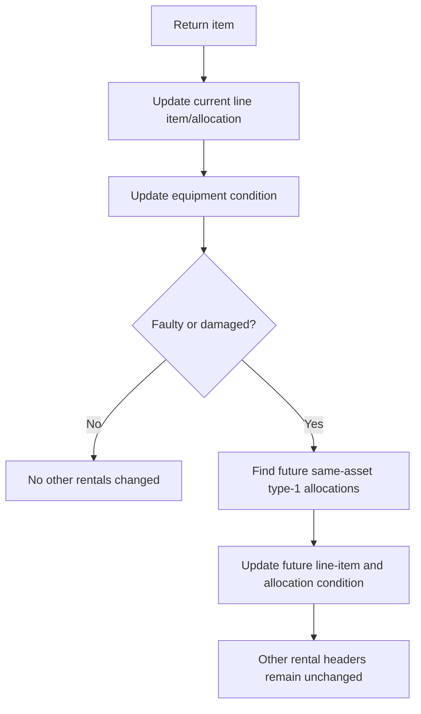

# Rental return process

The return endpoint is `POST /api/rental/bulk-return-items`, handled by `RentalController::bulkReturnItems()`.

## Request

```json
{
  "rental_id": 123,
  "items": {
    "line_item_id": 456,
    "product_id": 999,
    "return_quantity": 1,
    "return_date": "2026-11-19",
    "remarks": "Returned in good condition",
    "condition": "Good",
    "attachment_keys": []
  }
}
```

Required fields are the parent rental, line-item ID, return date, remarks, and condition. Accepted condition values include Good, Faulty, Damage, and Damaged in case variants. `return_quantity` is logged but not used to split a quantity in the current method.

## Processing sequence

1. Find the rental and the line item under that rental.
2. Map condition to asset status: Good `1`, Faulty `5`, Damaged `4`.
3. Update the selected line item with `asset_status`, `is_future_asset = 0`, and remarks.
4. Close the selected rental's allocation: `activated = 0`, `return_status = 1`, return date, and condition status.
5. Update the equipment master availability/status.
6. Write equipment activity and `rental_histories`.
7. Commit the transaction; roll back on exception.

## Effect on other rentals

Good return updates only the selected rental allocation and equipment master. Faulty/damaged return also finds future allocations for the same equipment where allocation `type = 1`, parent is different, dates overlap the future window, and line item type is `9`. Those future line items receive `asset_status = 5/4` and `is_future_asset = 1`; their allocations receive the condition status and remain pending (`return_status = null`). Other rental header statuses are not changed.



